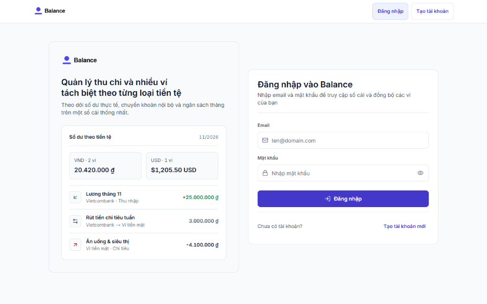
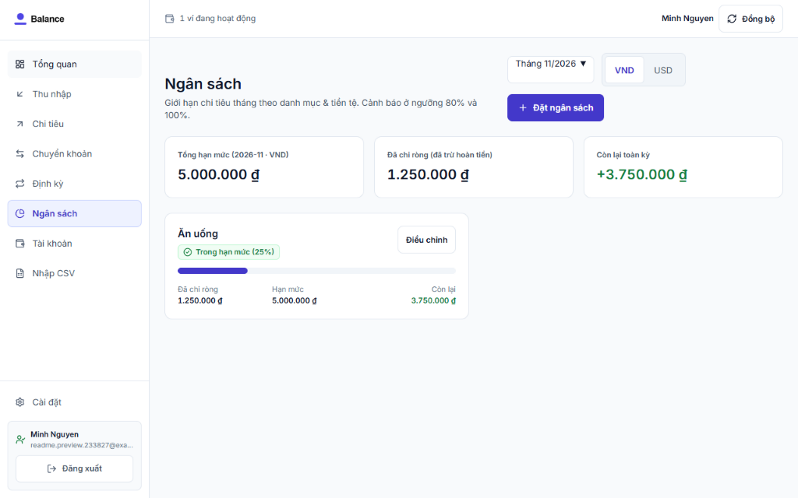
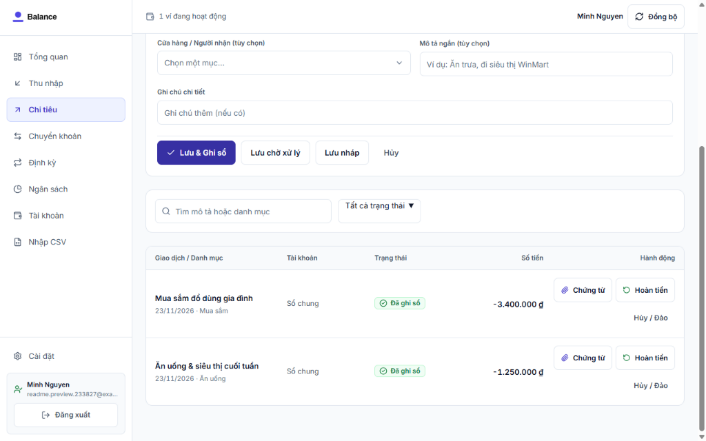
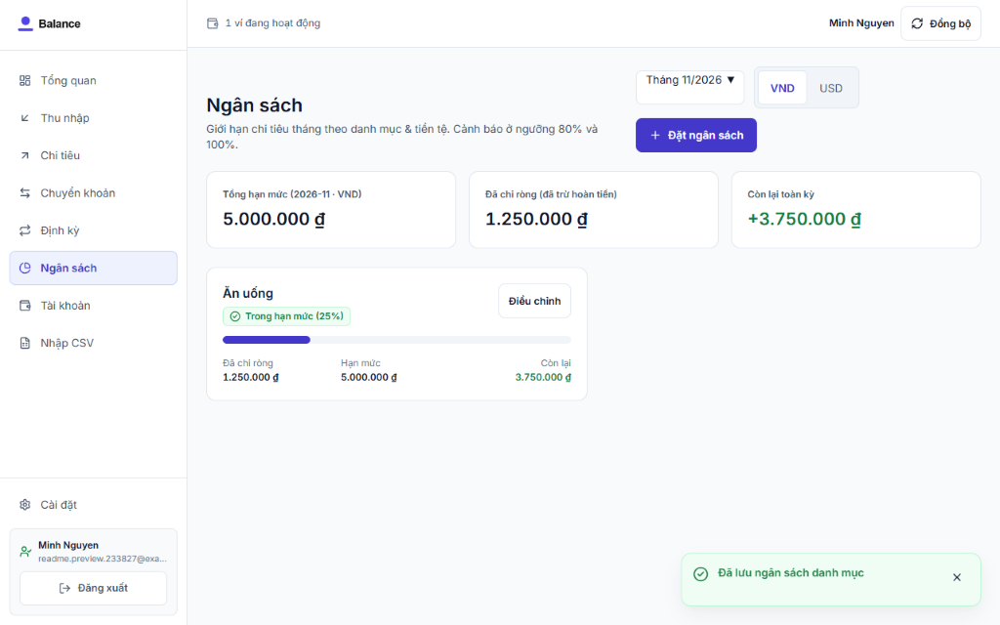

  

# Balance — Personal Finance Management

**Balance** is a personal finance application built to give individuals a clear, accurate, and explainable view of their money across multiple wallets and currencies.

## Why Balance?

Most everyday budgeting apps mix income, expenses, and transfers between a user's own accounts into a single stream—causing inflated spending totals, misleading cash-flow charts, and balances that never match real life.

**Balance** was created to solve three core problems:

- **True cash-flow clarity:** Income, Expenses (with linked Refunds), and Internal Transfers are treated as distinct financial concepts. Moving money between your own wallets never inflates your earnings or spending.
- **Multi-wallet & multi-currency accuracy:** Manage cash, bank accounts, e-wallets, and savings across currencies (such as VND, USD, EUR, JPY, and KWD) without silently combining different currencies into a meaningless total.
- **Calm, everyday control:** Fast transaction logging, monthly category budgets with early threshold alerts, recurring draft reminders, receipt attachments, and two-factor authentication—all designed to stay quiet, readable, and trustworthy.

---

## Core Modules

### 1. Secure Sign-In & Onboarding
Clean two-step onboarding with base currency setup and automatic system timezone detection, plus optional two-factor authentication (2FA) to keep personal financial records private.

### 2. Financial Overview & Cash Flow
Track total posted balances, total income, net expenses (automatically adjusted for refunds), net cash flow, and top monthly budgets—strictly separated by currency.

### 3. Dedicated Income & Expense Tracking
Log daily income and expenses in seconds with searchable categories, clear transaction states (posted, pending, draft, voided), linked expense refunds, and receipt attachments.

### 4. Monthly Category Budgets
Set monthly spending limits per category and currency with clear visual progress indicators and early warnings at 80% and 100% usage.

---

### Additional Capabilities
- **Internal Transfers:** Move funds between your own accounts (same-currency or cross-currency with explicit exchange rates) while separating transfer fees into their own expense record.
- **Recurring Schedules:** Define daily, weekly, monthly, or yearly schedules that generate draft entries for your review before posting.
- **Data Export & Privacy:** Export your financial records whenever you need them, with full user control over account data.
