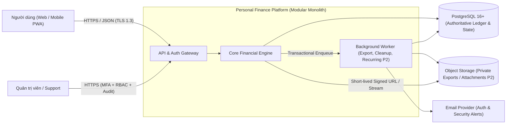
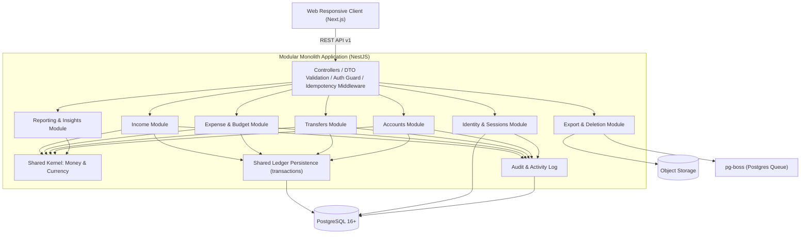

# 03 — Kiến trúc Hệ thống, Technology Stack & ADRs

## 1. Đánh giá & Lựa chọn Kiến trúc Tổng thể

### 1.1 So sánh các phương án kiến trúc

| Tiêu chí | Modular Monolith (Khuyến nghị) | Microservices | Serverless (FaaS + BaaS) |
| :--- | :--- | :--- | :--- |
| **Độ phức tạp vận hành** | **Thấp** — 1 deployable unit, 1 DB chính, dễ debug & trace | **Rất cao** — service discovery, distributed tracing, network failures | **Trung bình** — phụ thuộc vendor, khó test đồng bộ |
| **Toàn vẹn ACID** | **Xuất sắc** — Transfer, balance, idempotency trong 1 DB transaction | **Khó** — cần Saga / Outbox, rủi ro lệch số dư khi partial failure | **Hạn chế** — connection pooling phức tạp, cold start |
| **Ranh giới nghiệp vụ** | Rõ ràng nếu enforce bằng module boundaries & lint rules | Rõ ràng vật lý qua network | Dễ phân mảnh logic thành các hàm rời rạc |
| **Tốc độ phát triển MVP** | **Nhanh nhất** — không tốn overhead hạ tầng phân tán | **Chậm** — tốn công CI/CD, gateway, contracts | Nhanh lúc đầu, chậm khi logic tài chính phức tạp |
| **Khả năng mở rộng** | Dễ tách module (Reporting, Import/Export) thành worker/service khi cần | Scale độc lập từng service | Auto-scale nhưng tốn kém khi tải ổn định |

**Quyết định:** Chọn **Modular Monolith** cho MVP và giai đoạn tăng trưởng trung hạn. Mọi module (`Identity`, `Accounts`, `Income`, `Expense`, `Transfer`, `Reporting`) tách biệt ranh giới ở tầng code và contract, không gọi chéo vào bảng nội bộ của nhau.

### 1.2 Sơ đồ Ngữ cảnh Hệ thống (System Context Diagram)

### 1.3 Sơ đồ Module & Hướng phụ thuộc (Component Diagram)

**Dependency Direction:** `API Layer` -> `Feature Modules` -> `Domain Services & Shared Kernel` -> `Infrastructure`. Cấm circular dependency giữa `Income`, `Expense` và `Transfer`.

---

## 2. Đánh giá & Lựa chọn Technology Stack

| Lớp | Phương án cân nhắc | Lựa chọn Khuyến nghị | Lý do lựa chọn | Revisit Trigger (Khi nào đổi) |
| :--- | :--- | :--- | :--- | :--- |
| **Backend** | TypeScript (NestJS), Go (Gin), Python (FastAPI) | **TypeScript + NestJS** (Zod/class-validator + Drizzle hoặc Prisma) | Cấu trúc Modular Monolith tự nhiên, DI rõ ràng, chia sẻ types với FE, tốc độ dev cao. Dùng `bigint` cho tiền tệ để tránh lỗi `number`. | Khi CPU-bound report vượt single-node hoặc chuyển team sang Go/JVM. |
| **Frontend** | Next.js (Web Responsive), React Native / Flutter | **Next.js (App Router) + React + Tailwind CSS** | 1 codebase cho Desktop & Mobile Web, triển khai nhanh, dễ test E2E (Playwright), đáp ứng tốt UI/UX rules. | Khi >60% active users cần app native offline-first hoặc push notification di động. |
| **Database** | PostgreSQL 16+, MySQL 8, SQLite | **PostgreSQL 16+** | ACID chuẩn mực, `BIGINT` & `NUMERIC`, `CHECK` constraints, Partial Unique Indexes, Composite FK `(id, user_id)`, `TIMESTAMPTZ`, Window functions mạnh cho báo cáo. | Khi bảng `transactions` > 100M dòng -> Partition theo `transaction_date`. |
| **Auth** | Self-hosted Session/Token vs Managed Auth (Auth0/Clerk) | **Self-hosted Auth** (Argon2id + HttpOnly Secure Cookies + Refresh Rotation) | Kiểm soát 100% session revocation, không phụ thuộc chi phí MAU, không lộ metadata tài chính sang bên thứ 3. | Khi cần Enterprise SSO (SAML/OIDC) hoặc compliance bắt buộc tách IdP. |
| **Jobs** | `pg-boss` (Postgres), BullMQ (Redis), Temporal | **`pg-boss`** | Tận dụng ngay PostgreSQL, hỗ trợ **transactional enqueue** (enqueue job chung DB transaction), giảm 1 thành phần hạ tầng (Redis) ở MVP. | Khi throughput > 500 jobs/giây -> tách Redis + BullMQ. |
| **Hosting** | Managed PaaS (Railway/Render/Fly.io), AWS ECS+RDS, Serverless | **Managed PaaS + Managed PostgreSQL** (bật Automated Backups + PITR) | Setup nhanh, persistent DB connections (không cold-start), chi phí dự đoán được. | Khi cần VPC peering, data residency nghiêm ngặt -> AWS/GCP. |

---

## 3. Chuẩn REST API v1

### 3.1 Endpoints Cốt lõi
- **Auth:** `POST /api/v1/auth/register`, `POST /api/v1/auth/login`, `POST /api/v1/auth/refresh`, `POST /api/v1/auth/logout`, `POST /api/v1/auth/logout-all`
- **Accounts:** `GET / POST /api/v1/accounts`, `GET / PATCH /api/v1/accounts/:id`, `POST /api/v1/accounts/:id/archive`, `POST /api/v1/accounts/:id/adjustments`, `GET /api/v1/accounts/:id/ledger`
- **Incomes (Module riêng):** `GET / POST /api/v1/incomes` *(cho phép bỏ trống `account_id` -> tự động resolve sang Default Account của user)*, `GET / PATCH /api/v1/incomes/:id`, `POST /api/v1/incomes/:id/post`, `POST /api/v1/incomes/:id/void`, `POST /api/v1/incomes/:id/reverse`
- **Expenses (Module riêng):** `GET / POST /api/v1/expenses` *(cho phép bỏ trống `account_id` -> tự động resolve sang Default Account của user)*, `GET / PATCH /api/v1/expenses/:id`, `POST /api/v1/expenses/:id/post`, `POST /api/v1/expenses/:id/void`, `POST /api/v1/expenses/:id/reverse`, `POST /api/v1/expenses/:id/refunds`
- **Transfers (Module riêng):** `GET / POST /api/v1/transfers`, `GET /api/v1/transfers/:id`, `POST /api/v1/transfers/:id/void`, `POST /api/v1/transfers/:id/reverse`
- **Categories & Budgets:** `GET / POST / PATCH /api/v1/categories?kind=INCOME|EXPENSE`, `POST /api/v1/categories/:id/archive`, `GET / POST / PATCH /api/v1/budgets`
- **Reports & Data:** `GET /api/v1/reports/balances`, `GET /api/v1/reports/cash-flow?from=YYYY-MM-DD&to=YYYY-MM-DD&currency=VND`, `POST /api/v1/exports`, `DELETE /api/v1/users/me`

### 3.2 Quy chuẩn Contract
- **Ownership:** `user_id` chỉ lấy từ verified Auth Context; bỏ qua/từ chối mọi `user_id` client gửi lên. Trả `404 Not Found` nhất quán khi truy cập ID không thuộc user.
- **Idempotency:** Mọi `POST` ghi tài chính bắt buộc header `Idempotency-Key` (UUIDv4). Trùng key + trùng payload hash -> trả kết quả cũ; trùng key + khác payload -> `409 Conflict`.
- **Cursor Pagination:** `?limit=20&cursor=<base64(transaction_date,created_at,id)>`, sắp xếp ổn định `ORDER BY transaction_date DESC, created_at DESC, id DESC`.
- **Error Format (RFC 9457 Problem Details):** Không trả stack trace hay dữ liệu nhạy cảm.

---

## 4. Architecture Decision Records (ADRs)

1. **ADR-001: Modular Monolith cho MVP & Tăng trưởng Trung hạn**
   - *Quyết định:* Dùng Modular Monolith thay vì Microservices/Serverless.
   - *Lý do:* Đảm bảo ACID tuyệt đối cho transfer và idempotency, vận hành đơn giản, ship nhanh.
2. **ADR-002: Unified `transactions` Ledger + `transfers` Header + Tách biệt Domain/API**
   - *Quyết định:* Dùng bảng `transactions` làm sổ cái duy nhất kèm `CHECK` constraints chặt theo `entry_type`, nhưng tách hoàn toàn `IncomeModule`, `ExpenseModule`, `TransferModule` ở code và API.
   - *Lý do:* Đảm bảo sao kê tài khoản và tính số dư từ 1 nguồn sự thật (không cần `UNION ALL` dễ sai lệch), trong khi giữ ranh giới nghiệp vụ tuyệt đối.
3. **ADR-003: Biểu diễn Tiền tệ bằng `BIGINT` Minor Units + ISO 4217**
   - *Quyết định:* Lưu mọi số tiền dạng `BIGINT` (`amount_minor > 0`), tỷ giá dạng `NUMERIC(18, 8)`.
   - *Lý do:* Loại bỏ hoàn toàn sai số dấu phẩy động (floating-point).
4. **ADR-004: Tech Stack — NestJS + PostgreSQL 16+ + Next.js + `pg-boss`**
   - *Quyết định:* Stack TypeScript full-stack kết hợp PostgreSQL làm cả DB chính và Job Queue (`pg-boss`).
   - *Lý do:* Tối ưu type safety, giảm thành phần hạ tầng ở MVP.
5. **ADR-005: `Idempotency-Key`, Soft-Archive & Void/Reversal Policy**
   - *Quyết định:* Bắt buộc `Idempotency-Key` cho financial writes; cấm hard-delete dữ liệu đã `POSTED` hoặc master data có lịch sử.
   - *Lý do:* Chống trùng lặp do retry/double-click và bảo toàn tính kiểm toán tài chính.
