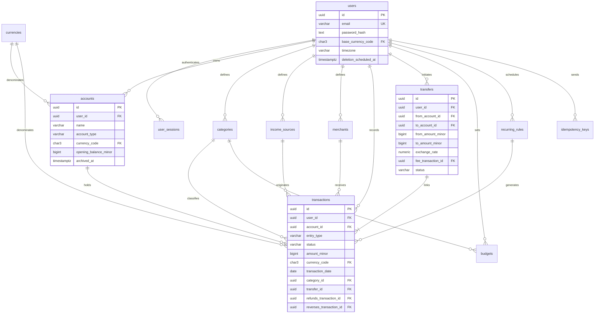

# 04 — Domain Model & Thiết kế Cơ sở Dữ liệu Ban đầu

## 1. Các Bất biến Tài chính & Mô hình Dữ liệu (Financial Invariants)

1. **Số học tiền tệ chính xác:**
   - Mọi số tiền lưu bằng `BIGINT` (`amount_minor > 0`) theo đơn vị nhỏ nhất (minor unit) của mã tiền tệ ISO 4217 (VD: `VND` có `minor_unit = 0`, `USD` có `minor_unit = 2`, `KWD` có `minor_unit = 3`).
   - Chiều tăng/giảm số dư do `entry_type` quyết định, không lưu số âm trong `amount_minor`.
   - Tỷ giá chuyển đổi lịch sử lưu dạng `NUMERIC(18, 8)` ngay trên bảng `transfers`, làm tròn bằng **Half-Even (Banker's Rounding)** tại biên chuyển đổi.

2. **Công thức Số dư Tài khoản (`POSTED` only):**
   $$\text{Posted Balance} = \text{opening\_balance\_minor} + \sum \text{INCOME} - \sum \text{EXPENSE} + \sum \text{EXPENSE\_REFUND} + \sum \text{TRANSFER\_IN} - \sum \text{TRANSFER\_OUT} + \sum \text{ADJUSTMENT\_CREDIT} - \sum \text{ADJUSTMENT\_DEBIT}$$
   - Chỉ tính các bản ghi có `status = 'POSTED'`. Các bản ghi `DRAFT`, `PENDING`, `VOIDED`, `REVERSED` không ảnh hưởng Posted Balance.

3. **Ngữ nghĩa Ngày tháng:**
   - `transaction_date DATE`: Ngày phát sinh tài chính theo múi giờ địa phương của người dùng (dùng cho lọc báo cáo và kỳ ngân sách).
   - `created_at` / `updated_at TIMESTAMPTZ`: Thời điểm ghi nhận hệ thống theo UTC.

4. **Cô lập dữ liệu theo User ở tầng DB (Database-level Tenant Isolation):**
   - Các bảng gốc (`accounts`, `categories`, `income_sources`, `merchants`, `transfers`) đều có `UNIQUE (id, user_id)`.
   - Bảng `transactions` và `budgets` dùng **Composite Foreign Keys `(entity_id, user_id)`**, khiến PostgreSQL từ chối ở tầng vật lý nếu có bất kỳ nỗ lực gắn giao dịch của User A vào tài khoản/danh mục của User B.

---

## 2. Sơ đồ Thực thể Quan hệ (Mermaid ER Diagram)



---

## 3. Thiết kế Cơ sở Dữ liệu PostgreSQL (Reconciled DDL)

```sql
CREATE EXTENSION IF NOT EXISTS pgcrypto;

-- 1. Currencies (Reference Data)
CREATE TABLE currencies (
    code        CHAR(3) PRIMARY KEY,
    name        VARCHAR(64) NOT NULL,
    minor_unit  SMALLINT NOT NULL CHECK (minor_unit BETWEEN 0 AND 4),
    symbol      VARCHAR(10) NOT NULL
);

-- 2. Users & Preferences
CREATE TABLE users (
    id                      UUID PRIMARY KEY DEFAULT gen_random_uuid(),
    email                   VARCHAR(255) NOT NULL UNIQUE,
    password_hash           TEXT NOT NULL,
    full_name               VARCHAR(120) NOT NULL,
    base_currency_code      CHAR(3) NOT NULL REFERENCES currencies(code),
    timezone                VARCHAR(64) NOT NULL DEFAULT 'Asia/Ho_Chi_Minh',
    mfa_enabled             BOOLEAN NOT NULL DEFAULT FALSE,
    deletion_scheduled_at   TIMESTAMPTZ,
    created_at              TIMESTAMPTZ NOT NULL DEFAULT now(),
    updated_at              TIMESTAMPTZ NOT NULL DEFAULT now()
);

-- 3. User Sessions & Refresh Token Rotation (Security)
CREATE TABLE user_sessions (
    id                  UUID PRIMARY KEY DEFAULT gen_random_uuid(),
    user_id             UUID NOT NULL REFERENCES users(id) ON DELETE CASCADE,
    token_family_id     UUID NOT NULL,
    refresh_token_hash  CHAR(64) NOT NULL UNIQUE,
    user_agent_hash     CHAR(64),
    expires_at          TIMESTAMPTZ NOT NULL,
    revoked_at          TIMESTAMPTZ,
    created_at          TIMESTAMPTZ NOT NULL DEFAULT now()
);
CREATE INDEX idx_sessions_user_active ON user_sessions(user_id) WHERE revoked_at IS NULL;

-- 4. Accounts
CREATE TABLE accounts (
    id                      UUID PRIMARY KEY DEFAULT gen_random_uuid(),
    user_id                 UUID NOT NULL REFERENCES users(id) ON DELETE RESTRICT,
    name                    VARCHAR(100) NOT NULL,
    account_type            VARCHAR(20) NOT NULL CHECK (account_type IN ('CASH', 'BANK', 'E_WALLET', 'CREDIT_CARD', 'SAVINGS')),
    currency_code           CHAR(3) NOT NULL REFERENCES currencies(code),
    opening_balance_minor   BIGINT NOT NULL DEFAULT 0,
    opening_balance_date    DATE NOT NULL,
    is_default              BOOLEAN NOT NULL DEFAULT FALSE,
    archived_at             TIMESTAMPTZ,
    created_at              TIMESTAMPTZ NOT NULL DEFAULT now(),
    updated_at              TIMESTAMPTZ NOT NULL DEFAULT now(),
    UNIQUE (id, user_id)
);
CREATE INDEX idx_accounts_user_active ON accounts(user_id) WHERE archived_at IS NULL;
CREATE UNIQUE INDEX idx_accounts_one_default_per_user
    ON accounts(user_id) WHERE is_default = TRUE AND archived_at IS NULL;

-- 5. Categories (Tách biệt loại INCOME vs EXPENSE)
CREATE TABLE categories (
    id              UUID PRIMARY KEY DEFAULT gen_random_uuid(),
    user_id         UUID NOT NULL REFERENCES users(id) ON DELETE RESTRICT,
    kind            VARCHAR(10) NOT NULL CHECK (kind IN ('INCOME', 'EXPENSE')),
    name            VARCHAR(80) NOT NULL,
    parent_id       UUID,
    archived_at     TIMESTAMPTZ,
    created_at      TIMESTAMPTZ NOT NULL DEFAULT now(),
    UNIQUE (id, user_id),
    UNIQUE (id, user_id, kind),
    FOREIGN KEY (parent_id, user_id) REFERENCES categories(id, user_id)
);
CREATE UNIQUE INDEX idx_categories_unique_active_name
    ON categories(user_id, kind, lower(name)) WHERE archived_at IS NULL;

-- 6. Income Sources & Merchants
CREATE TABLE income_sources (
    id          UUID PRIMARY KEY DEFAULT gen_random_uuid(),
    user_id     UUID NOT NULL REFERENCES users(id) ON DELETE RESTRICT,
    name        VARCHAR(100) NOT NULL,
    archived_at TIMESTAMPTZ,
    created_at  TIMESTAMPTZ NOT NULL DEFAULT now(),
    UNIQUE (id, user_id)
);

CREATE TABLE merchants (
    id          UUID PRIMARY KEY DEFAULT gen_random_uuid(),
    user_id     UUID NOT NULL REFERENCES users(id) ON DELETE RESTRICT,
    name        VARCHAR(100) NOT NULL,
    archived_at TIMESTAMPTZ,
    created_at  TIMESTAMPTZ NOT NULL DEFAULT now(),
    UNIQUE (id, user_id)
);

-- 7. Transfers (Aggregate Header)
CREATE TABLE transfers (
    id                  UUID PRIMARY KEY DEFAULT gen_random_uuid(),
    user_id             UUID NOT NULL REFERENCES users(id) ON DELETE RESTRICT,
    from_account_id     UUID NOT NULL,
    to_account_id       UUID NOT NULL,
    from_amount_minor   BIGINT NOT NULL CHECK (from_amount_minor > 0),
    from_currency_code  CHAR(3) NOT NULL REFERENCES currencies(code),
    to_amount_minor     BIGINT NOT NULL CHECK (to_amount_minor > 0),
    to_currency_code    CHAR(3) NOT NULL REFERENCES currencies(code),
    exchange_rate       NUMERIC(18, 8) NOT NULL DEFAULT 1.0 CHECK (exchange_rate > 0),
    rate_source         VARCHAR(50) NOT NULL DEFAULT 'USER_SUPPLIED',
    rate_effective_at   TIMESTAMPTZ NOT NULL DEFAULT now(),
    fee_transaction_id  UUID,
    transfer_date       DATE NOT NULL,
    note                VARCHAR(500),
    status              VARCHAR(12) NOT NULL DEFAULT 'POSTED' CHECK (status IN ('POSTED', 'VOIDED', 'REVERSED')),
    voided_at           TIMESTAMPTZ,
    created_at          TIMESTAMPTZ NOT NULL DEFAULT now(),
    updated_at          TIMESTAMPTZ NOT NULL DEFAULT now(),
    CHECK (from_account_id <> to_account_id),
    UNIQUE (id, user_id),
    FOREIGN KEY (from_account_id, user_id) REFERENCES accounts(id, user_id),
    FOREIGN KEY (to_account_id, user_id)   REFERENCES accounts(id, user_id)
);

-- 8. Recurring Rules (Phase 2+)
CREATE TABLE recurring_rules (
    id              UUID PRIMARY KEY DEFAULT gen_random_uuid(),
    user_id         UUID NOT NULL REFERENCES users(id) ON DELETE RESTRICT,
    rule_kind       VARCHAR(10) NOT NULL CHECK (rule_kind IN ('INCOME', 'EXPENSE')),
    account_id      UUID NOT NULL,
    category_id     UUID NOT NULL,
    amount_minor    BIGINT NOT NULL CHECK (amount_minor > 0),
    currency_code   CHAR(3) NOT NULL REFERENCES currencies(code),
    frequency       VARCHAR(16) NOT NULL CHECK (frequency IN ('DAILY', 'WEEKLY', 'MONTHLY', 'YEARLY')),
    interval_count  SMALLINT NOT NULL DEFAULT 1 CHECK (interval_count > 0),
    next_run_date   DATE NOT NULL,
    end_date        DATE,
    timezone        VARCHAR(64) NOT NULL,
    is_active       BOOLEAN NOT NULL DEFAULT TRUE,
    created_at      TIMESTAMPTZ NOT NULL DEFAULT now(),
    updated_at      TIMESTAMPTZ NOT NULL DEFAULT now(),
    UNIQUE (id, user_id),
    FOREIGN KEY (account_id, user_id) REFERENCES accounts(id, user_id),
    FOREIGN KEY (category_id, user_id, rule_kind) REFERENCES categories(id, user_id, kind)
);

-- 9. Unified Authoritative Ledger (transactions)
CREATE TABLE transactions (
    id                      UUID PRIMARY KEY DEFAULT gen_random_uuid(),
    user_id                 UUID NOT NULL REFERENCES users(id) ON DELETE RESTRICT,
    account_id              UUID NOT NULL,
    entry_type              VARCHAR(20) NOT NULL CHECK (entry_type IN (
                                'INCOME', 'EXPENSE', 'EXPENSE_REFUND',
                                'TRANSFER_OUT', 'TRANSFER_IN',
                                'ADJUSTMENT_CREDIT', 'ADJUSTMENT_DEBIT'
                            )),
    status                  VARCHAR(12) NOT NULL DEFAULT 'POSTED' CHECK (status IN (
                                'DRAFT', 'PENDING', 'POSTED', 'VOIDED', 'REVERSED'
                            )),
    amount_minor            BIGINT NOT NULL CHECK (amount_minor > 0),
    currency_code           CHAR(3) NOT NULL REFERENCES currencies(code),
    transaction_date        DATE NOT NULL,
    description             VARCHAR(255),
    note                    TEXT,
    category_id             UUID,
    income_source_id        UUID,
    merchant_id             UUID,
    transfer_id             UUID,
    recurring_rule_id       UUID,
    occurrence_date         DATE,
    refunds_transaction_id  UUID,
    reverses_transaction_id UUID,
    voided_at               TIMESTAMPTZ,
    created_at              TIMESTAMPTZ NOT NULL DEFAULT now(),
    updated_at              TIMESTAMPTZ NOT NULL DEFAULT now(),

    -- Tenant Isolation Composite FKs
    FOREIGN KEY (account_id, user_id)        REFERENCES accounts(id, user_id),
    FOREIGN KEY (category_id, user_id)       REFERENCES categories(id, user_id),
    FOREIGN KEY (income_source_id, user_id)  REFERENCES income_sources(id, user_id),
    FOREIGN KEY (merchant_id, user_id)       REFERENCES merchants(id, user_id),
    FOREIGN KEY (transfer_id, user_id)       REFERENCES transfers(id, user_id),
    FOREIGN KEY (recurring_rule_id, user_id) REFERENCES recurring_rules(id, user_id),
    FOREIGN KEY (refunds_transaction_id)     REFERENCES transactions(id),
    FOREIGN KEY (reverses_transaction_id)    REFERENCES transactions(id),

    -- Strict Type-Specific Invariants
    CONSTRAINT chk_tx_income_rules CHECK (
        entry_type <> 'INCOME' OR (
            category_id IS NOT NULL AND merchant_id IS NULL AND transfer_id IS NULL AND refunds_transaction_id IS NULL
        )
    ),
    CONSTRAINT chk_tx_expense_rules CHECK (
        entry_type <> 'EXPENSE' OR (
            category_id IS NOT NULL AND income_source_id IS NULL AND transfer_id IS NULL AND refunds_transaction_id IS NULL
        )
    ),
    CONSTRAINT chk_tx_refund_rules CHECK (
        entry_type <> 'EXPENSE_REFUND' OR (
            category_id IS NOT NULL AND income_source_id IS NULL AND transfer_id IS NULL
        )
    ),
    CONSTRAINT chk_tx_transfer_rules CHECK (
        entry_type NOT IN ('TRANSFER_OUT', 'TRANSFER_IN') OR (
            transfer_id IS NOT NULL AND category_id IS NULL AND income_source_id IS NULL AND merchant_id IS NULL AND refunds_transaction_id IS NULL
        )
    )
);

ALTER TABLE transfers
    ADD CONSTRAINT fk_transfers_fee_tx
    FOREIGN KEY (fee_transaction_id) REFERENCES transactions(id);

CREATE INDEX idx_tx_user_date ON transactions(user_id, transaction_date DESC, created_at DESC, id DESC) WHERE status = 'POSTED';
CREATE INDEX idx_tx_account_date ON transactions(account_id, transaction_date DESC) WHERE status = 'POSTED';
CREATE INDEX idx_tx_user_type_date ON transactions(user_id, entry_type, transaction_date) WHERE status = 'POSTED';
CREATE UNIQUE INDEX idx_tx_recurring_idempotent ON transactions(recurring_rule_id, occurrence_date) WHERE recurring_rule_id IS NOT NULL;

-- 10. Budgets (Chỉ áp dụng cho EXPENSE categories)
CREATE TABLE budgets (
    id              UUID PRIMARY KEY DEFAULT gen_random_uuid(),
    user_id         UUID NOT NULL REFERENCES users(id) ON DELETE RESTRICT,
    category_id     UUID NOT NULL,
    category_kind   VARCHAR(10) NOT NULL DEFAULT 'EXPENSE' CHECK (category_kind = 'EXPENSE'),
    limit_minor     BIGINT NOT NULL CHECK (limit_minor > 0),
    currency_code   CHAR(3) NOT NULL REFERENCES currencies(code),
    period_start    DATE NOT NULL,
    period_end      DATE NOT NULL,
    archived_at     TIMESTAMPTZ,
    created_at      TIMESTAMPTZ NOT NULL DEFAULT now(),
    CHECK (period_end >= period_start),
    FOREIGN KEY (category_id, user_id, category_kind) REFERENCES categories(id, user_id, kind)
);

-- 11. Idempotency Keys & Audit Logs
CREATE TABLE idempotency_keys (
    user_id         UUID NOT NULL REFERENCES users(id) ON DELETE CASCADE,
    idempotency_key VARCHAR(128) NOT NULL,
    request_method  VARCHAR(10) NOT NULL,
    request_path    VARCHAR(255) NOT NULL,
    request_hash    CHAR(64) NOT NULL,
    response_status SMALLINT,
    response_body   JSONB,
    created_at      TIMESTAMPTZ NOT NULL DEFAULT now(),
    expires_at      TIMESTAMPTZ NOT NULL,
    PRIMARY KEY (user_id, idempotency_key)
);

CREATE TABLE audit_logs (
    id          UUID PRIMARY KEY DEFAULT gen_random_uuid(),
    user_id     UUID NOT NULL,
    entity_type VARCHAR(40) NOT NULL,
    entity_id   UUID NOT NULL,
    action      VARCHAR(30) NOT NULL,
    metadata    JSONB NOT NULL DEFAULT '{}'::jsonb,
    created_at  TIMESTAMPTZ NOT NULL DEFAULT now()
);
CREATE INDEX idx_audit_user_created ON audit_logs(user_id, created_at DESC);
```

*(Lưu ý tầng Application Service: Bắt buộc kiểm tra `transactions.currency_code == accounts.currency_code` và `categories.kind` khớp với `INCOME` hoặc `EXPENSE`/`EXPENSE_REFUND` trong cùng DB transaction.)*
