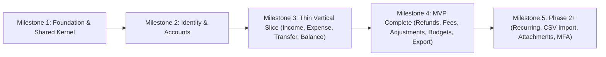

# 06 — Lộ trình Phát triển, Đánh giá Rủi ro & Câu hỏi Mở

## 1. Lộ trình Phát triển Có Thứ tự Ưu tiên (Prioritized Development Roadmap)

Lộ trình được sắp xếp theo nguyên tắc: **Chứng minh tính đúng đắn của Sổ cái & Số dư (Vertical Slice) trước -> Hoàn thiện Nghiệp vụ MVP -> Tự động hóa & Mở rộng (Phase 2+)**.

### Chi tiết từng Giai đoạn & Phụ thuộc

| Giai đoạn | Hạng mục công việc | Phụ thuộc | Tiêu chí hoàn thành (Exit Gate) |
| :--- | :--- | :--- | :--- |
| **Milestone 1: Foundation & Shared Kernel** | - Khởi tạo Monorepo/Modular Monolith (NestJS + Next.js + PostgreSQL 16+) - Seed `currencies` (ISO 4217), `Money` value object (`bigint`) - RFC 9457 Error Handler, Structured Logger (Log Redaction), CI Security Scans | Chốt Tech Stack & Repo setup | Build/Lint xanh; Unit test `Money` arithmetic (0 sai số); Logger verified không in sensitive fields. |
| **Milestone 2: Identity & Accounts** | - `users` & `user_sessions` (Argon2id, HttpOnly Cookie, Refresh Rotation + Reuse Detection) - `accounts` CRUD, Opening Balance, Archive policy, Balance formula | Milestone 1 | Integration test Auth + Cross-user isolation (User A vs B); Account balance reconciliation test pass. |
| **Milestone 3: Core Ledger & Thin Vertical Slice (P0)** | - `idempotency_keys` middleware - `categories` (`INCOME`/`EXPENSE`), `income_sources`, `merchants` - `IncomeModule`, `ExpenseModule`, `TransferModule` (Atomic + Cross-currency) - Core Reports (`balances`, `cash-flow` tách tiền tệ, drill-down) - UI theo `ui-ux-rules` (Skeletons, Optimistic UI, 1 accent color) | Milestone 2 | E2E flow chạy thông suốt; Concurrent transfer & Idempotency tests pass; Net Cash Flow loại trừ 100% transfers. |
| **Milestone 4: MVP Complete (P1)** | - `EXPENSE_REFUND` (gắn giao dịch gốc), Transfer Fees tách `EXPENSE`, Balance Adjustments - Monthly `budgets` + cảnh báo 80%/100% - Async CSV/JSON Export (`pg-boss` + chống CSV Injection) & Account Deletion (Step-up + grace period) | Milestone 3 | Đạt 100% Acceptance Criteria P0+P1; Pass Security Verification Plan (DAST/SAST/Isolation). |
| **Milestone 5: Phase 2+ (P2)** | - Recurring Transactions (User-confirmed drafts/reminders) - Bulk CSV Import (Preview + Duplicate Detection) - Attachments / Receipts (Private Object Storage + Magic bytes check) - MFA (TOTP / Passkeys) | Milestone 4 & vận hành ổn định | Đảm bảo không làm sai lệch dữ liệu lịch sử MVP. |

---

## 2. Đánh giá Rủi ro Tổng hợp (Risk Assessment)

| Nhóm | Rủi ro | Mức độ | Biện pháp giảm thiểu |
| :--- | :--- | :---: | :--- |
| **Bảo mật** | **IDOR (Truy cập chéo dữ liệu user khác)** | Critical | Composite FK `(id, user_id)` ở PostgreSQL + Server Auth Guard + Automated Isolation Tests. |
| **Tài chính** | **Double-spend / Race condition khi Transfer** | High | Lock `accounts` theo thứ tự `id ASC` (`SELECT ... FOR UPDATE`) trong ACID transaction + `Idempotency-Key`. |
| **Tài chính** | **Trộn lẫn tiền tệ trong báo cáo / ngân sách** | High | API báo cáo & ngân sách bắt buộc 1 `currency_code` duy nhất; UI tách riêng khối/tab theo tiền tệ. |
| **Kỹ thuật** | **JS `Number` overflow (> `2^53 - 1`) hoặc sai số float** | Medium | Dùng `bigint` trong TS và `BIGINT` trong Postgres; serialize JSON an toàn; validate biên nhập liệu. |
| **Sản phẩm** | **Giả định hành vi người dùng chưa kiểm chứng** | Medium | Ship nhanh Thin Vertical Slice (M3) để thu thập phản hồi thực tế trước khi làm các tính năng P2. |
| **Vận hành** | **Dữ liệu user đã xóa còn trong Backup cũ** | Low-Med | Mã hóa backup, giới hạn quyền restore, tự hết hạn theo vòng đời backup retention (30–90 ngày). |

---

## 3. Câu hỏi Mở cần User Phê duyệt trước Giai đoạn Lập trình (Open Questions)

Trước khi chuyển sang **Phase 2 (Khởi tạo Repo & Lập trình)**, Orchestrator đề nghị User xác nhận các quyết định sản phẩm sau (hoặc phê duyệt dùng **giả định mặc định** đã đề xuất):

1. **OQ-01 (Quy đổi đa tiền tệ ở Báo cáo MVP):**
   - *Mặc định đề xuất:* Tách riêng báo cáo theo từng loại tiền tệ gốc (không tự quy đổi gộp về Base Currency ở MVP).
   - *Câu hỏi:* Bạn đồng ý giữ nguyên phương án tách riêng này cho MVP, hay muốn bổ sung nhập tỷ giá thủ công để xem tổng quy đổi?
2. **OQ-02 (Số dư âm ở Tài khoản):**
   - *Mặc định đề xuất:* Cho phép tài khoản về số dư âm kèm cảnh báo mềm (soft warning) để không chặn người dùng khi quên nhập thu nhập trước.
   - *Câu hỏi:* Bạn muốn cho phép kèm cảnh báo mềm hay chặn cứng không cho âm đối với ví Tiền mặt / Ví điện tử?
3. **OQ-03 (Chính sách Hoàn tiền khác tháng):**
   - *Mặc định đề xuất:* Khoản hoàn tiền (`EXPENSE_REFUND`) làm giảm chi tiêu của kỳ chứa **ngày phát sinh hoàn tiền** (để không làm thay đổi số liệu tháng cũ đã chốt).
   - *Câu hỏi:* Bạn đồng ý tính theo ngày hoàn tiền hay muốn trừ ngược vào tháng của giao dịch gốc?
4. **OQ-04 (Xác nhận Tech Stack):**
   - *Mặc định đề xuất:* **TypeScript (NestJS) + PostgreSQL 16+ + Next.js (App Router) + `pg-boss`**.
   - *Câu hỏi:* Bạn có yêu cầu hoặc ràng buộc đặc biệt nào khác về ngôn ngữ/framework (VD: Go, Python, .NET, hoặc Mobile Native) không?
